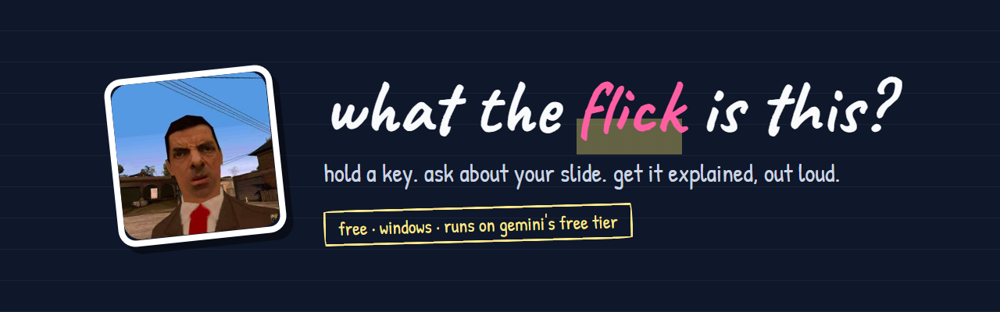
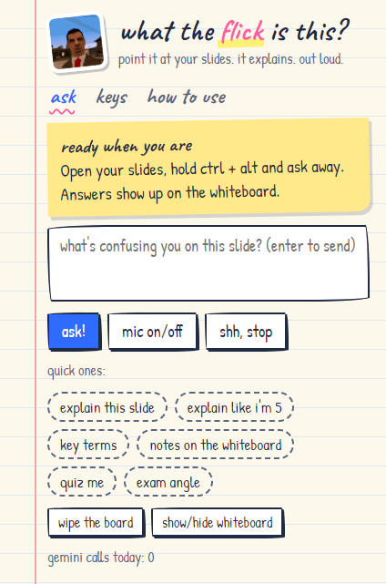

<div align="center">



# what the flick is this?

**A free, screen-aware AI study buddy for Windows.** Hold a key, ask about the slide, PDF or diagram on your screen, and it explains it out loud while building an explainer card on a whiteboard. Made for students learning from PPTs and lecture notes, with no paid APIs.

<p>
  
  
  
  
  
  
</p>

[Quickstart](#installation--quickstart) · [How it works](#system-architecture) · [Report a Bug](https://github.com/sarthakviche/what-the-flick-is-this/issues)

<br>


&nbsp;&nbsp;


<sub>Left: the explainer card for a sample slide about the artificial neuron. Right: the panel. Both rendered by the real app code.</sub>

</div>

---

## About & Key Features

You hold `Ctrl + Alt` and ask a question out loud. The app records your voice, turns it into text, takes a screenshot of every monitor, and sends both to Gemini's free vision model. Gemini replies with structured JSON steps: what to say, which part of the screen it means, and what to write on the whiteboard. The app then plays the steps one by one. It speaks each sentence with a local neural voice and fills in a whiteboard card: a zoomed snapshot of that part of your slide, key terms, LaTeX formulas and Mermaid diagrams.

<table>
  <tr>
    <td width="33%" valign="top">
      <h3>🗣️ Ask out loud</h3>
      Hold <code>Ctrl + Alt</code>, speak, let go. Or type, or use one-click prompts: <i>explain this slide</i>, <i>explain like I'm 5</i>, <i>key terms</i>, <i>quiz me</i>, <i>exam angle</i>.
    </td>
    <td width="33%" valign="top">
      <h3>🧾 Explainer cards</h3>
      Each answer pins a padded snapshot of the region it's talking about, plus key terms, formulas (KaTeX) and diagrams (Mermaid) on a chalkboard-style whiteboard.
    </td>
    <td width="33%" valign="top">
      <h3>💸 Free to run</h3>
      Gemini Flash-Lite free tier for the brain, optional free Groq Whisper for voice input, Kokoro running locally for the voice. No credit card and no server.
    </td>
  </tr>
</table>

- **Built for the free tier.** Flash-Lite answers by default because its free daily quota is far bigger than Flash's. Each question makes at most 3 attempts when Google is busy (HTTP 503/429), switching models between them. Retired model ids (HTTP 404) are skipped. A counter in the panel shows Gemini calls per Pacific-time day, which is when Google resets free quotas.
- **Explains your screen without marking it.** Free vision models give loose coordinates, so instead of drawing boxes over your real screen, answers crop a generous region into the whiteboard. Close is good enough. The older on-screen mode is still available as `ANNOTATION_MODE=overlay`.
- **Natural voice, offline.** Kokoro (82M parameters, Apache 2.0) runs in a separate background process and starts playing one sentence while it generates the next. It uses the Windows voice until its model has downloaded, or if it fails.
- **Structured JSON output.** The model answers in a fixed JSON format with `box_2d` regions on a 0–1000 scale for each screen, so multiple monitors and Windows display scaling need no special handling.
- **Keys in the app.** A keys page with step-by-step instructions, "test it" buttons and a settings section. Keys stay in a git-ignored local `.env`.
- **One click.** `start-what-the-flick.cmd` installs everything on first run and creates a Desktop and Start menu shortcut.

---

## System Architecture

```
  INPUT                         PROCESSING                                  OUTPUT
  ─────                         ──────────                                  ──────
  hold Ctrl+Alt ──► mic recorder (hidden renderer, 16 kHz WAV)
                        │
                        ▼
                    speech to text ── auto: Groq Whisper (if key) │ Gemini audio
                        │
                        ▼  transcript
  all monitors ──► screen capture (JPEG ≤1600px, labeled screen1..N)
                        │
                        ▼
                    Gemini Flash-Lite ── JSON schema ──► { steps: [ {say, mark?, board[]} ] }
                    (fallback Flash, ≤3 tries, 404s skipped)
                        │
                        ▼
                    CompanionSession (src/core/session.js), for each step in order:
                        ├── mark  ──► crop screenshot (padded) ─────────►  whiteboard: snapshot card
                        ├── board ──► heading │ term │ math │ code │ diagram ►  whiteboard (KaTeX, Mermaid, hljs)
                        └── say   ──► Kokoro worker (child process) ──────►  hidden audio player ► speakers
                                      └─ prepares next sentences ahead     (falls back to Windows SAPI)
```

| Layer | Location | Notes |
|---|---|---|
| Core logic (no Electron) | `windows-local/src/core/` | Response format and cleanup, coordinate and crop math, system prompt, session orchestrator |
| Providers | `windows-local/src/providers/` | `llm/` Gemini, Ollama · `stt/` Gemini, Groq, faster-whisper · `tts/` Kokoro, SAPI, Piper, silent |
| Electron shell | `windows-local/src/main/` | Panel, tray, whiteboard, overlay, recorder, audio player, push-to-talk hook, settings, usage counter |
| Pages | `windows-local/src/renderer/` | Panel, whiteboard, overlay, recorder and player pages (handwritten notebook style) |

---

## Tech Stack

<p>
  
  
  
  
  
  
  
  
  
  
  
</p>

From `windows-local/package.json`: `electron`, `kokoro-js`, `katex`, `mermaid`, `@highlightjs/cdn-assets`, `dotenv`, `@fontsource/caveat`, `@fontsource/patrick-hand`, and optionally `uiohook-napi` for the global push-to-talk hook. Gemini and Groq are called over plain REST with `fetch`; no SDKs.

---

## Installation & Quickstart

**Prerequisites**

| Requirement | Version / where to get it |
|---|---|
| Windows | 10 (2004+) or 11, x64 |
| Node.js | 20 or newer, [nodejs.org](https://nodejs.org) (LTS) |
| Gemini API key | Free, [aistudio.google.com/apikey](https://aistudio.google.com/apikey), no card needed |
| Groq API key *(optional)* | Free, [console.groq.com/keys](https://console.groq.com/keys): faster voice input, saves Gemini quota |
| Microphone and speakers | For voice. Typing works without them. |

**Option A: one click**

1. Clone or download this repo.
2. Double-click **`start-what-the-flick.cmd`**. The first run installs dependencies (about 2 minutes) and creates a **what the flick is this** shortcut on your Desktop and in the Start menu.
3. The app opens on the **keys** page. Paste your Gemini key, click **test it**, then **save**.

**Option B: terminal**

```powershell
git clone https://github.com/sarthakviche/what-the-flick-is-this.git
cd what-the-flick-is-this\windows-local
npm install
copy .env.example .env
notepad .env                      # set GEMINI_API_KEY= (or skip and use the in-app keys page)
npm run doctor                    # checks your config and key
npm start
```

**Key settings** (`windows-local/.env`, all editable from the keys page):

| Variable | Default | Options |
|---|---|---|
| `GEMINI_API_KEY` | (empty) | your key |
| `GROQ_API_KEY` | (empty) | optional |
| `GEMINI_MODEL` | `gemini-flash-lite-latest` | any Gemini model id your key can use |
| `STT_PROVIDER` | `auto` | `auto`, `gemini`, `groq`, `faster-whisper`, `none` |
| `TTS_PROVIDER` | `kokoro` | `kokoro`, `sapi`, `piper`, `none` |
| `KOKORO_VOICE` | `af_heart` | `af_bella`, `af_nicole`, `am_michael`, `am_fenrir`, `bf_emma`, `bm_george` |
| `ANNOTATION_MODE` | `card` | `card`, `overlay` |
| `PUSH_TO_TALK_KEYS` | `ctrl+alt` | `ctrl+shift`, `alt+shift` |
| `LLM_PROVIDER` | `gemini` | `gemini`, `ollama` (fully local, experimental) |

> **Privacy:** every question sends a screenshot of **all your monitors** to Google. On the free tier Google may use that content to improve its products, so close private windows before asking, or use `LLM_PROVIDER=ollama`.

---

## Usage Examples

**Ask about your screen.** Open a lecture PDF or PPT, hold `Ctrl + Alt`, then say:

```text
"explain this slide step by step"
"what's the difference between sigmoid and relu here?"
"derive this formula on the whiteboard"
"quiz me on this slide"
```

**Shortcuts**

| Keys | Action |
|---|---|
| hold `Ctrl + Alt` | push to talk (release to send) |
| `Ctrl + Alt + Space` | mic on / off toggle |
| `Alt + Shift + X` | clear on-screen marks (overlay mode) |

**Check your setup** (`npm run doctor`, real output):

```powershell
PS> cd windows-local
PS> npm run doctor
OK   LLM_PROVIDER=gemini STT_PROVIDER=auto TTS_PROVIDER=kokoro
OK   Gemini key works (model gemini-flash-lite-latest).
```

**Run the tests** (no Electron, network or keys needed):

```powershell
PS> npm test
# tests 41
# pass 41
# fail 0
```

**The format the model answers in** (what Gemini returns for each question, defined in `src/core/schema.js`):

```json
{
  "mode": "whiteboard",
  "steps": [
    {
      "say": "so this slide is about the artificial neuron.",
      "clear_board": true,
      "mark": { "type": "box", "box_2d": [330, 290, 750, 780], "label": "the neuron diagram" },
      "board": [
        { "kind": "heading", "content": "the artificial neuron" },
        { "kind": "term", "content": "bias: a constant nudge added before activation" },
        { "kind": "math", "content": "z = \\sum_i w_i x_i + b" },
        { "kind": "diagram", "content": "flowchart LR; A[inputs] --> B[weighted sum] --> C[activation]" }
      ]
    }
  ]
}
```

**Add a provider.** Write one file that implements `generatePlan`, `transcribe` or `speak`, then add one line to `windows-local/src/providers/index.js`.

---

## Roadmap

- [x] Push-to-talk voice questions, plus typing and one-click study prompts
- [x] Multi-monitor screen capture → Gemini structured JSON answers
- [x] Whiteboard explainer cards: snapshot, key terms, KaTeX, Mermaid, code highlighting
- [x] Free-tier handling: Flash-Lite default, capped retries, model fallback, daily usage counter
- [x] Kokoro local neural voice with Windows voice fallback
- [x] In-app keys page with tutorials and key testing
- [x] One-click launcher and Desktop shortcut
- [ ] Exact word positions from local Windows OCR, so marks land precisely without paid models
- [ ] Start speaking before the whole answer arrives (streaming JSON) to cut waiting time
- [ ] Packaged installer (`.exe`) so Node.js isn't required
- [ ] Save explainer cards as revision notes (PDF / Markdown export)
- [ ] macOS and Linux builds

---

## Contributing & License

Issues and pull requests are welcome.

1. [Open an issue](https://github.com/sarthakviche/what-the-flick-is-this/issues) describing the bug or idea.
2. Fork, create a branch (`feature/short-description` or `fix/short-description`), and keep `cd windows-local && npm test` passing.
3. Open a PR against `main` explaining *why* the change is needed.

Licensed under the [MIT License](LICENSE).

This project builds on the idea and system-prompt style of [Clicky](https://github.com/farzaa/clicky) by Farza (MIT). The original macOS Swift app (`leanring-buddy/`) and Cloudflare Worker (`worker/`) are included unmodified for reference; the upstream README is in [`README_ORIGINAL_CLICKY.md`](README_ORIGINAL_CLICKY.md). Everything under `windows-local/` is new work.

---

<div align="center">

**Built by Sarthak Viche**

</div>
