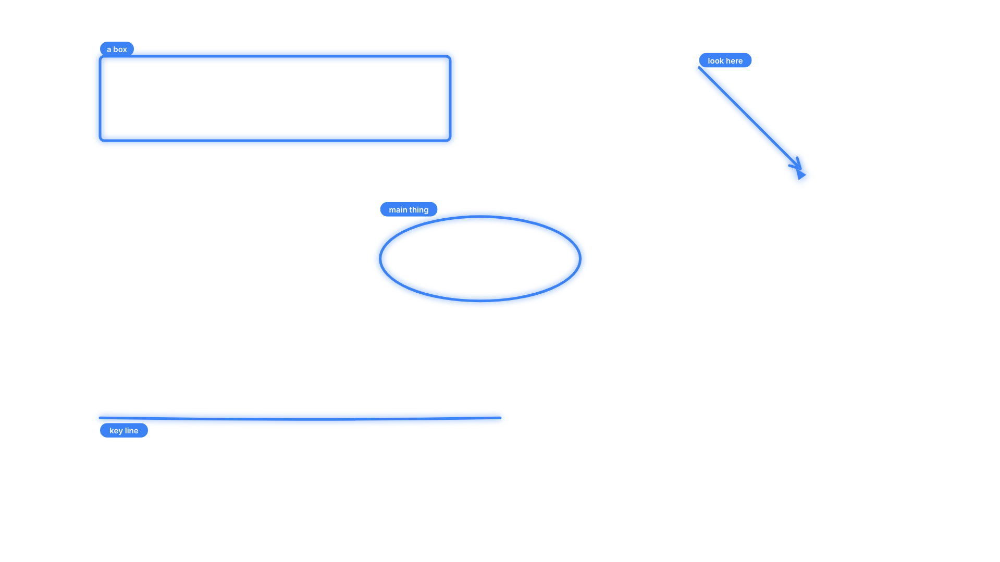
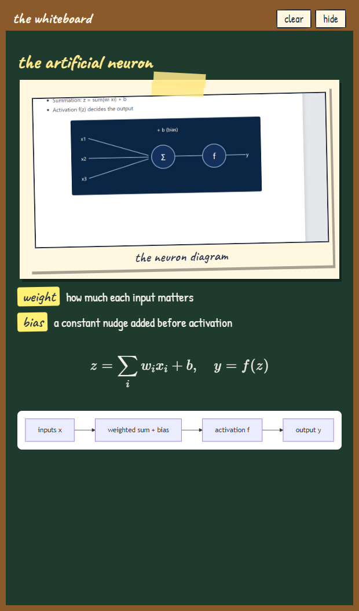

# what the flick is this

**A free, screen-aware AI study buddy for Windows, made for people learning from PPTs, PDFs and lecture notes.** Hold a key, ask out loud about whatever is on your screen, and it answers by voice, draws circles, boxes, arrows and underlines directly on your screen, and writes step-by-step derivations and code walkthroughs on a whiteboard while it talks.

Built for exam preparation by a B.Tech IT student. It costs nothing to run: no Claude, no AssemblyAI, no ElevenLabs, no cloud proxy.




*Screenshots are rendered by the real app code under a virtual display. The overlay is transparent on a real desktop; here it sits on a blank background.*

## The problem

Studying from lecture PDFs, code, circuit diagrams and past papers means constantly switching to a chatbot, pasting text, and then hunting for "which line did it mean?". Most screen-aware assistants are Mac only or need paid API keys.

## What it does

1. **Push to talk.** Hold `Ctrl+Alt`, ask, release. (Fallbacks: `Ctrl+Alt+Space`, a mic button, or typing.)
2. **Sees your screen.** Screenshots of every display go to a vision model.
3. **Answers by voice** in a short, spoken style, with a natural local voice (Kokoro).
4. **Builds an explainer card** on the whiteboard for every answer: a zoomed snapshot of the part of your slide it is talking about, key terms in plain words, and a small diagram. (The older mode that draws on the screen itself is still there as `ANNOTATION_MODE=overlay`, but free models place those marks loosely.)
5. **Whiteboard mode.** For derivations, worked maths, code walkthroughs and diagrams, a docked window fills in line by line while each step is spoken. Maths is rendered with KaTeX, code with highlight.js, diagrams with Mermaid.

Example questions: "which button runs the program?", "what does this line do?", "derive the quotient rule on the whiteboard", "explain how a B tree insert works with a diagram".

## How it works

```
hold Ctrl+Alt -> mic recorder -> speech to text -> transcript
                 screenshots of all displays
transcript + screenshots + history -> vision LLM (JSON schema output)
    -> { steps: [ { say, mark?, board?[] } ] }
for each step: draw mark on overlay, write board lines, speak the sentence
```

The model returns **structured JSON, not inline text tags**. Boxes use Gemini's `box_2d` format `[ymin, xmin, ymax, xmax]` normalized 0 to 1000 per screen, so multi monitor and Windows display scaling need no special handling.

### Swappable providers

| Job | Default (free) | Alternatives |
|---|---|---|
| Vision + reasoning | Gemini Flash-Lite free tier (Flash as backup) | Ollama with Qwen3-VL (fully local, experimental) |
| Speech to text | Groq Whisper if you add a free key, else Gemini audio | Groq Whisper (free key, faster), faster-whisper (local) |
| Text to speech | Kokoro (natural, local, free) | Windows voices (SAPI), Piper, silent mode |

Adding a provider is one file plus one line in `windows-local/src/providers/index.js`.

### Key design decisions (full reasoning in `docs/PLAN.md`)

- **New Electron client instead of porting the Swift app.** The original Clicky is macOS only (ScreenCaptureKit, NSPanel, CGEvent). The Windows community port Clacky is Python with paid APIs. Electron gives transparent click-through overlays, multi display capture and a web view for the whiteboard in one codebase.
- **Normalized 0-1000 coordinates** instead of pixel coordinates.
- **KaTeX + highlight.js + Mermaid for the whiteboard** instead of tldraw or Excalidraw, because exam content is mostly text based derivations, code and flow diagrams.
- **Ordered board queue** so lines from a short step can never overtake the previous step's lines (a real bug found in testing, now covered by a test).
- **Wait for the full JSON before playback.** Simple and robust. Streaming partial JSON would cut about a second or two of latency and is a follow-up.

## Run it on Windows (one click)

1. Install [Node.js LTS](https://nodejs.org) once.
2. Double click **`start-what-the-flick.cmd`** in this folder. The first run installs everything (a minute or two) and puts a **what the flick is this** shortcut with the app icon on your Desktop and in the Start menu. After that, use the shortcut.
3. The app opens on the **keys** page with a 1 minute tutorial. Paste a free Gemini key from https://aistudio.google.com/apikey, hit **test it**, then **save**. (Optional: a free Groq key from https://console.groq.com/keys for faster voice input.)
4. Open your slides, hold `Ctrl+Alt`, ask "explain this slide", let go.

Manual route and all options: [`windows-local/README.md`](windows-local/README.md).

## Testing and honest limits

- **Passing:** 28 unit tests (`cd windows-local && npm test`) covering response schema, coordinate maths, session orchestration, provider requests with mocked HTTP, overlay SVG output and the WAV encoder.
- **Also run:** the real overlay, whiteboard, screen capture and app boot under a Linux virtual display, with a fake model.
- **Not run (no Windows machine, no route to Google, no audio devices in the build environment):** a live Gemini call, transparent click-through behavior on Windows, the `uiohook-napi` push-to-talk hook, microphone capture, SAPI and Piper playback, faster-whisper, Ollama, and how precisely Gemini places boxes on real screens.
- The default model id in `.env.example` came from a docs lookup and should be confirmed in Google AI Studio. `npm run doctor` reports if it is stale.
- Free tier Gemini is rate limited. The app retries and falls back to other models listed in `GEMINI_FALLBACK_MODELS`.

## Privacy

Each question sends screenshots of all displays to the model provider. On Gemini's free tier, Google's terms say content may be used to improve their products, so close private windows first or use the local Ollama path. API keys live only in a git-ignored `.env`.

## Project layout

```
windows-local/        the Windows app (this project)
  src/core/             schema, coordinate math, prompt, session orchestrator (no Electron imports)
  src/providers/        llm/ stt/ tts/ implementations
  src/main/             Electron main process: overlay, whiteboard, tray, hotkey, recorder
  src/renderer/         overlay, whiteboard, panel and recorder pages
  sidecar/              optional faster-whisper helper
  test/                 unit tests and a manual Electron smoke test
docs/PLAN.md          plan, Windows decision and architecture
leanring-buddy/       original macOS Swift app (reference, untouched)
worker/               original Cloudflare Worker proxy (reference, not used)
README_ORIGINAL_CLICKY.md   the upstream README
```

## Credits and license

Based on the idea and system prompt style of [Clicky](https://github.com/farzaa/clicky) by Farza (MIT license, see `LICENSE`). The Swift macOS code and Cloudflare Worker in this folder are the unmodified originals, included for reference. All code under `windows-local/` and `docs/PLAN.md` is new work for this project. Raynan00/clacky was read as a reference for Windows approaches, and no code was copied from it. If your hackathon has rules about prior work, disclose that this builds on Clicky's open source idea.
